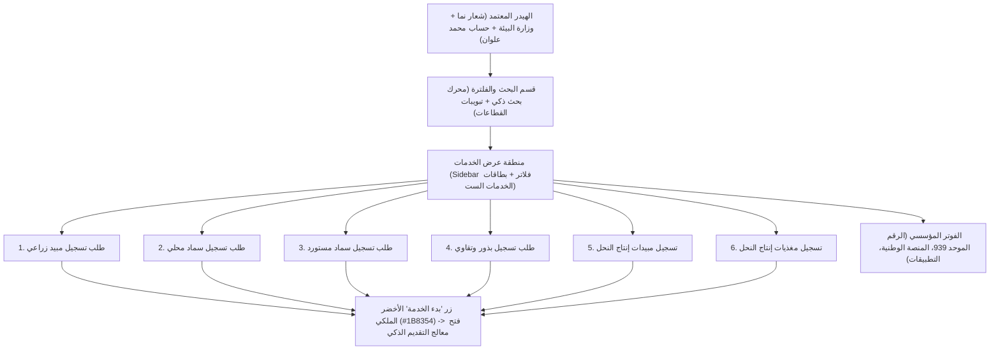

# توثيق إعادة تصميم الشاشة الرئيسية (HomePage) وفق هوية منصة نما

> [!NOTE]
> تم استهداف شاشة **[HomePage](https://va4roh.axshare.com/#id=3w2geh&p=homepage)** بالتحديد، حيث تمت مطابقة كافة العناصر والنصوص من نموذج Axure السلكي وتحويلها إلى واجهة تفاعلية حديثة ومتكاملة طبقاً للمنصة الرسمية **[منصة نما - الخدمات](https://naama.sa/services)**.

---

## 1. جدول مطابقة وتحويل عناصر شاشة HomePage (Element Mapping)

| العنصر في Axure القديم (`homepage.html`) | النص والمحتوى السابق | التحويل في هوية "نما" المعتمدة (2026) | التحسينات المضافة لتجربة المستخدم (UX) |
| :--- | :--- | :--- | :--- |
| `u1, u23, u24, u25` | عن نما، التحول الرقمي، الأسئلة الشائعة، تواصل معنا | شريط المنظومة الحكومية العلوي وشبكة الروابط في الهيدر والفوتر | خط `IBM Plex Sans Arabic` مع مسافات مريحة وتوافق مع قارئات الشاشة |
| `u26, u27` | طلباتي، مفضلتي | عناصر تنقل رئيسية في الهيدر مع عدادات نشطة للأرقام (Badges) | شارة تفاعلية تعرض عدد المعاملات الجارية (3) |
| `u28, u30` | محمد علوان، تغيير الحساب | بطاقة الحساب الحكومي المعتمدة (User Pill Dropdown) | إظهار اسم المنشأة، الصورة الرمزية، وقائمة تبديل الحساب المفوض |
| `u32` | الخدمات الإلكترونية | عنوان القسم ومسار التصفح (Breadcrumb) | `الرئيسية > الخدمات الإلكترونية > القطاع الزراعي` |
| `u76, u89, u90` | خدمات، تتيح هذه الخدمة...، **طلب تسجيل مبيد** | **بطاقة خدمة رئيسية: طلب تسجيل مبيد زراعي** | أيقونة فئة الوقاية، شارة مستوى الخدمة، مدة الإنجاز (15 يوم)، الرسوم (1,500 ر.س)، زر "بدء الخدمة" الأخضر الملكي `#1B8354`، وزر المفضلة. |
| `u94, u98, u99` | خدمات، تتيح هذه الخدمة...، **طلب تسجيل سماد محلي** | **بطاقة خدمة رئيسية: طلب تسجيل سماد محلي** | تصنيف الأسمدة والمخصبات، رسوم (1,000 ر.س)، مدة 10 أيام، وخيار البدء الفوري. |
| `u121, u125, u126` | خدمات، تتيح هذه الخدمة...، **طلب تسجيل سماد مستورد** | **بطاقة خدمة رئيسية: طلب تسجيل سماد مستورد** | تصنيف الاستيراد والجمارك، رسوم (1,200 ر.س)، مدة 12 يوماً. |
| `u112, u116, u117` | خدمات، تتيح هذه الخدمة...، **طلب تسجيل بذور** | **بطاقة خدمة رئيسية: طلب تسجيل بذور وتقاوي** | تصنيف البذور والتقاوي، رسوم (800 ر.س)، شهادات ISTA للإنبات. |
| `u103, u107, u108` | خدمات، تتيح هذه الخدمة...، **طلب تسجيل مبيدات انتاج النحل** | **بطاقة خدمة رئيسية: تسجيل مبيدات إنتاج النحل** | تصنيف الثروة النحلية، مكافحة آفات الخلية، رسوم (600 ر.س). |
| `u130, u134, u135` | خدمات، تتيح هذه الخدمة...، **طلب تسجيل مغذيات انتاج النحل** | **بطاقة خدمة رئيسية: تسجيل مغذيات إنتاج النحل** | مكملات التغذية السكرية والبروتينية، رسوم (500 ر.س)، مدة 7 أيام. |
| `u48 - u75` | الفوتر، الرقم 939، App Store، Google Play | الفوتر المؤسسي المعتمد لوزارة البيئة والمياه والزراعة | لون كحلي مؤسسي `#193661`، روابط المنصة الوطنية، وشارة الدخول الآمن. |

---

## 2. الهيكل البصري ومسار التفاعل في الشاشة المعاد تصميمها

---

## 3. روابط المعاينة المباشرة

- **ملف الشاشة الرئيسية المعاد تصميمها:** [homepage_redesign.html](file:///C:/Users/admin/.gemini/antigravity/scratch/naama_redesign/homepage_redesign.html)
- **ملف معالج التقديم والسداد الكامل:** [index.html](file:///C:/Users/admin/.gemini/antigravity/scratch/naama_redesign/index.html)
- **الشعار الرسمي لمنصة نما:** [nama-logo.svg](file:///C:/Users/admin/.gemini/antigravity/scratch/naama_redesign/nama-logo.svg)
