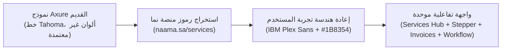
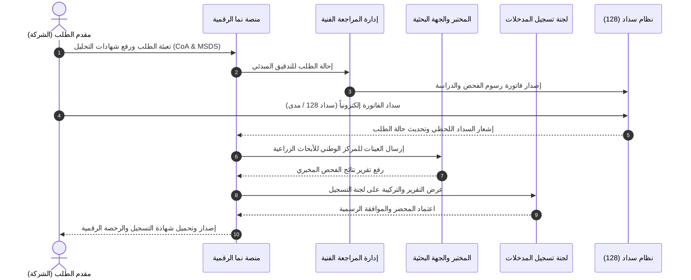

# دليل ومواصفات إعادة تصميم الخدمات الزراعية وفق هوية منصة "نما" (Naama)

> [!IMPORTANT]
> تم استخراج رموز الهوية البصرية (Design Tokens)، والخطوط الرسمية، ولوحة الألوان المعيارية مباشرة من المنصة الرسمية **[منصة نما - دليل الخدمات](https://naama.sa/services)** ومطابقتها وتطبيقها على جميع الخدمات الزراعية المشمولة في نموذج **Axure Share** السابق.

---

## 1. ملخص المشروع والتحليل المقارن (Before vs. After)

### أ. الوضع السابق في نموذج Axure القديم (`va4roh.axshare.com`)
كان النموذج السلكي السابق يعتمد على أسلوب النماذج المبدئية السريعة (Wireframes)، وكان يعاني من عدة نواقص رئيسية:
- **الخطوط:** استخدام خط `Tahoma` العادي وهو خط تقليدي قديم يفتقر لأوزان التدرج الطباعي الحديث ولا يطابق الخط الحكومي المعتمد.
- **الألوان:** ألوان سلكية عشوائية (أزرق افتراضي `#169BD5`، رمادي باهت `#D7D7D7`، أخضر داكن حاد `#073216` و `#139E4F`).
- **تجربة المستخدم (UX):** تداخل الحقول، وغياب مؤشرات التحقق السريع، واعتماد شاشات دفع ثابتة تفتقر إلى تكامل نظام سداد الوطني (128).
- **التجاوب:** تخطيط يعتمد على إحداثيات بكسل مطلقة (Absolute Pixels) غير متجاوب مع الأجهزة الذكية والأجهزة اللوحية.

### ب. الوضع الحالي بعد إعادة التصميم بالهوية الرسمية لمنصة "نما"
- **الخط الرسمي:** اعتماد خط **`IBM Plex Sans Arabic`** بكافة أوزانه (Regular 400, Medium 500, SemiBold 600, Bold 700).
- **لوحة الألوان المعتمدة:** الأخضر الملكي لـ "نما" (`#1B8354`) مع خلفيات رقيقة (`#F3FCF6`)، والكحلي الداكن المؤسسي (`#193661`)، والأزرق المساعد (`#4789C8`).
- **مكونات التصميم (Design System Components):** بطاقات خدمات حديثة، معالج تقديم متقدم (Stepper Wizard)، بطاقات اختيار تفاعلية (Radio Cards)، ومنطقة رفع ملفات حديثة (Dropzone).
- **نظام السداد:** مطابقة كاملة لفاتورة سداد الحكومية لوزارة البيئة والمياه والزراعة بالرمز المفوتر **128**.

---

## 2. مصفوفة رموز التصميم المعتمدة (Design Tokens)

تم استخراج هذه القيم الدقيقة من ملفات الأنماط الأساسية لمنصة نما (`header.min.css`, `footer.min.css`, `e-services.min.css`):

### أ. لوحة الألوان (Color Palette)

| اسم المتغير (Token) | الرمز اللوني (HEX) | الاستخدام وتجربة المستخدم |
| :--- | :--- | :--- |
| **`--naama-primary`** | `#1B8354` | اللون الأخضر الرئيسي للأزرار، المؤشرات النشطة، والهوية البصرية |
| **`--naama-primary-hover`** | `#146C43` | حالة التحويم (Hover) والتفاعل للأزرار الرئيسية |
| **`--naama-primary-light`** | `#F3FCF6` | خلفيات البطاقات المحددة، التنبيهات الإيجابية، وأيقونات الخدمات |
| **`--naama-secondary`** | `#193661` | اللون الكحلي المؤسسي لوزارة البيئة والمياه والزراعة وفوتر المنصة |
| **`--naama-accent-blue`** | `#4789C8` | لون الروابط الفرعية وشارات الإجراءات المساعدة |
| **`--text-heading`** | `#161616` | لون العناوين الرئيسية وأسماء الخدمات (أقصى درجات التباين والوضوح) |
| **`--text-body`** | `#384250` | لون نصوص الفقرات والشروحات والبيانات |
| **`--text-muted`** | `#6C737F` | لون النصوص الثانوية، التسميات التوضيحية، والنصوص المساعدة |
| **`--border-default`** | `#D2D6DB` | حدود الحقول والبطاقات والجداول المعتمدة |
| **`--bg-body`** | `#F9FAFB` | الخلفية العامة للصفحات والمنظومة |

### ب. النمط الطباعي (Typography Scale)

- **اسم الخط:** `IBM Plex Sans Arabic` (محمل عبر Google Fonts وبدائل النظام).
- **تدرج الأحجام:**
  - **العنوان الرئيسي (Hero Title):** `2.2rem` (35px) - Bold 700.
  - **عناوين الأقسام (Section Title):** `1.4rem` (22px) - SemiBold 600.
  - **عناوين بطاقات الخدمات (Card Title):** `1.15rem` (18px) - Bold 700.
  - **نص المتن الأساسي (Body Text):** `0.925rem` (15px) - Regular 400 - Line Height 1.6.
  - **النصوص المساعدة والشارات (Captions & Badges):** `0.75rem` - `0.825rem` (12-13px) - Medium 500.

---

## 3. تفاصيل الخدمات الزراعية المعاد تصميمها

| الخدمة في Axure القديم | الاسم المعتمد في التصميم الجديد | المكونات والمراحل الإجرائية المضافة |
| :--- | :--- | :--- |
| `homepage.html` | **دليل الخدمات الزراعية الإلكترونية** | تصنيف الخدمات، بطاقات تفاعلية مع شارات القطاع، عرض مدة التنفيذ والرسوم وزر بدء الخدمة المباشر. |
| `requestpesticides.html` | **طلب تسجيل مبيد زراعي** | معالج من 4 خطوات: بيانات المنشأة، درجة السمية المعتمدة (WHO Class U إلى Ia)، المادة الفعالة، ورفع شهادات CoA و MSDS. |
| `requestfertilizer.html` | **طلب تسجيل سماد (محلي / مستورد)** | تحديد نوع السماد (مركب، محسنات، وسائط)، التركيب الكيميائي NPK، وهيئة السماد (صلب/سائل)، وتحديد المنشأ. |
| `requestseeds.html` | **طلب تسجيل بذور وتقاوي** | نقاء الصنف، بيئة الزراعة (محمي/مكشوف)، فحص الإنبات المعتمد دولياً (ISTA)، وبلد المنشأ. |
| `requestbees1.html` & `2` | **تسجيل مدخلات ومبيدات النحل** | مستحضرات مكافحة آفات الخلية (الفاروا)، المكملات الغذائية السكرية والبروتينية المعتمدة. |
| `payinovice.html` | **مركز سداد الفواتير الحكومية** | فاتورة مفصلة بالرمز المفوتر الوطني **128 (وزارة البيئة)**، مع خيارات سداد، مدى، وفيزا. |
| `agricturerequest.html` & `workflow` | **لوحة متابعة الاعتماد الإداري** | تتبع المسار الإجرائي عبر 6 مراحل: (تقديم > دراسة مبدئية > سداد > فحص مختبري > لجنة التسجيل > إصدار الشهادة). |

---

## 4. مسار سير عمل المعاملة الزراعية (Agricultural Workflow)

---

## 5. تشغيل ومعاينة النموذج التفاعلي المكتمل

تم بناء النموذج التفاعلي عالي الدقة وتخزينه في مسار المشروع:
- **ملف المعاينة الرئيسي:** [index.html](file:///C:/Users/admin/.gemini/antigravity/scratch/naama_redesign/index.html)
- **الشعار الرسمي لمنصة نما:** [nama-logo.svg](file:///C:/Users/admin/.gemini/antigravity/scratch/naama_redesign/nama-logo.svg)

> [!TIP]
> يمكنك فتح الملف مباشرة في أي متصفح ويب وتجربة:
> 1. التبديل بين بطاقات دليل الخدمات والبدء المباشر لأي معاملة.
> 2. استعراض معالج التقديم المتعدد الخطوات (Stepper) وتغيير نوع الخدمة وتجربة السداد التفاعلي.
> 3. استعراض جدول الفواتير وسداد الفاتورة بنقرة واحدة.
> 4. متابعة سير العمل الإجرائي للطلبات من واقع لوحة التحكم الإدارية.
