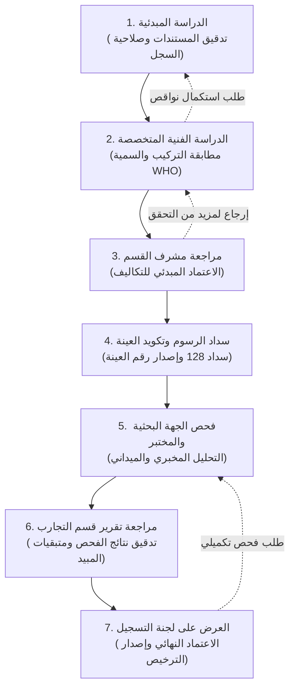

# توثيق نظام معالجة الطلبات وفق خيط سير العمل المعتمد (WorkFlow)

> [!IMPORTANT]
> تم بناء هذا النظام استناداً إلى خيط سير العمل المعتمد في نموذج Axure:  
> **[WorkFlow](https://va4roh.axshare.com/#id=zja07w&p=workflow&g=1)**  
> ودمج شاشات المراجعة والتدقيق الثمانية (`adminreview1` إلى `adminreview8` و `researchrequest` و `mewareview`) داخل منظومة معالجة موحدة مطابقة لهوية منصة **نما (Naama)** الرسمية.

---

## 1. مسار خيط سير العمل الإجرائي المعتمد (The 7-Stage Workflow Pipeline)

يتكون مسار تدقيق واعتماد طلبات المدخلات الزراعية (مبيدات، أسمدة، بذور، نحل) من **7 مراحل إجرائية متسلسلة**:

---

## 2. جدول مصفوفة الصلاحيات والإجراءات عبر المراحل السبع

| المرحلة الإجرائية | المسؤول / الدور الوظيفي | الإجراءات والقرارات المتاحة | شاشة Axure الأصلية المقابلة |
| :--- | :--- | :--- | :--- |
| **1. الدراسة المبدئية** | موظف دراسة وتدقيق المعاملات | • إرسال إلى الدراسة الفنية • طلب استكمال مستندات ونواقص • رفض الطلب مسبباً | `adminreview1.html` |
| **2. الدراسة الفنية** | باحث فني (وقاية/أسمدة/بذور) | • إرسال لمشرف القسم الزراعي • إرجاع للدراسة المبدئية | `adminreview2.html` |
| **3. مشرف القسم** | رئيس وحدة التسجيل | • اعتماد مبدئي وإحالة لتكويد العينة • إرجاع للدراسة الفنية | `adminreview3.html` |
| **4. سداد الرسوم والعينة** | مشرف عمليات التسجيل | • التحقق من سداد الرسوم الحكومية • إصدار وتعيين رقم العينة (Sample ID) • إحالة العينة للمركز البحثي | `adminreview4.html` `adminreview5.html` |
| **5. الجهة البحثية والمختبر** | مسؤول المختبر والجهة البحثية | • إثبات استلام العينة وتاريخها • تنفيذ بروتوكول التحليل • إرفاق نتيجة وتقرير التجربة (CoA) | `researchrequest.html` `adminreview6.html` |
| **6. مراجعة تقرير التجارب** | مشرف قسم التجارب الزراعية | • تدقيق مطابقة نتائج الفحص للمواصفات • إحالة التقرير الفني لعمليات التسجيل | `adminreview7.html` `adminreview8.html` |
| **7. لجنة التسجيل والاعتماد** | أعضاء لجنة تسجيل المدخلات | • **اعتماد نهائي وإصدار الرخصة الرقمية** • طلب إعادة الفحص المخبري • رفض نهائي | `mewarequest.html` `mewareview.html` |

---

## 3. الميزات التفاعلية المطبقة في صفحة معالجة الطلبات الجديدة

1. **خيط سير عمل مرئي تفاعلي (Visual Stepper Filter):**
   - مؤشر يعرض المراحل السبع مع عدادات للطلبات المعلقة في كل مرحلة.
   - النقر على أي مرحلة يقوم بتصفية جدول المعاملات فورياً.
2. **محاكي تبديل الأدوار (Role Switcher):**
   - إمكانية التبديل بين أدوار العمل (موظف دراسة مبدئية، باحث فني، مشرف قسم، جهة بحثية، لجنة التسجيل) وتخصيص الصلاحيات حسب الدور.
3. **درج المعالجة المتكامل (Order Processing Drawer):**
   - استعراض بيانات الشركة المفوضة والسجل التجاري النشط.
   - استعراض المواصفات الفنية للمنتج ومرفقات التحليل وشهادات السلامة (MSDS & CoA).
   - نموذج اتخاذ القرار المخصص للمرحلة الحالية مع خانة الملاحظات الإلزامية.
   - تحديث حالة الطلب ومساره الإجرائي بنقرة زر مع إشعارات النجاح.

---

## 4. ملفات المعاينة المباشرة

- **صفحة معالجة الطلبات وسير العمل:** [workflow_processing.html](file:///C:/Users/admin/.gemini/antigravity/scratch/naama_redesign/workflow_processing.html)
- **شاشة الدليل الرئيسية (HomePage):** [homepage_redesign.html](file:///C:/Users/admin/.gemini/antigravity/scratch/naama_redesign/homepage_redesign.html)
- **شعار منصة نما الرسمي:** [nama-logo.svg](file:///C:/Users/admin/.gemini/antigravity/scratch/naama_redesign/nama-logo.svg)
